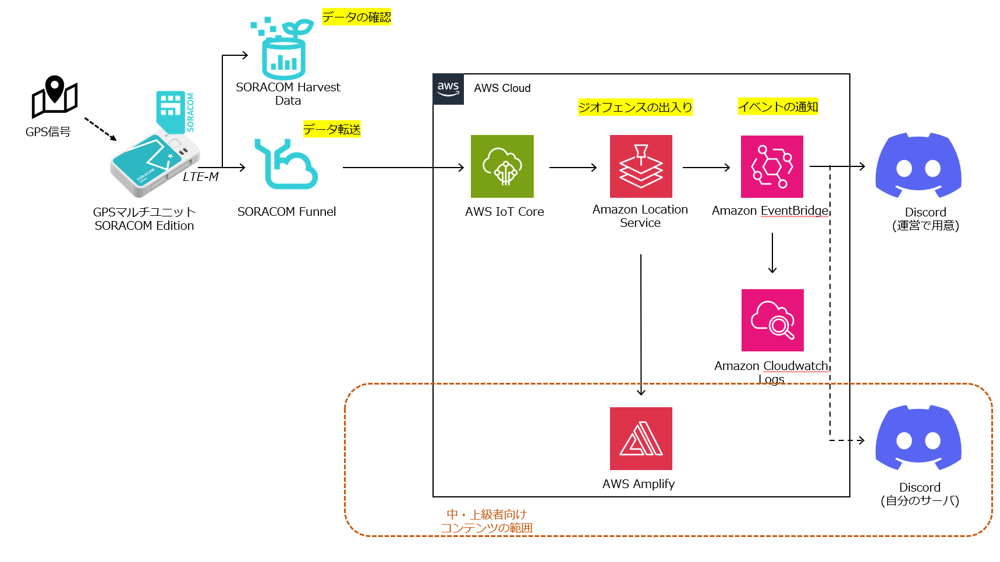
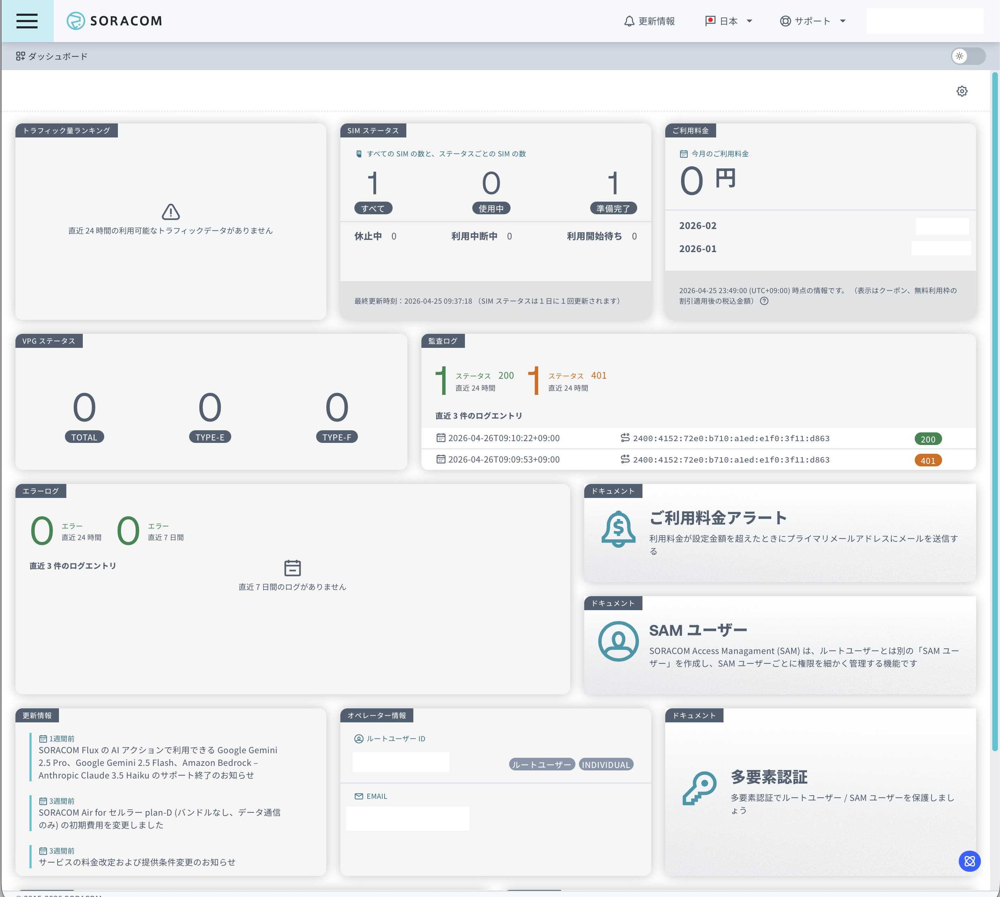

# 1a: GPSトラッカーシミュレータ初期設定(インストール～ARC設定)

## 前提

このドキュメントを進めるにあたって、以下のデバイスが必要となります。

- Android(10以上、16以上推奨)またはiOS(17.6以上)でGPSが使えるスマートフォン

このドキュメントを進めるにあたって、以下のアカウントが必要となります。

- SORACOM

## 構成図



## ユーザーコンソールへのログイン手順

SORACOMユーザーコンソールへのログイン手順を解説します。

### ユーザーコンソールへログインする

[SORACOM ユーザーコンソール](https://auth.soracom.io/login/) へアクセスします。ログイン画面が表示されますので、ご自身のメールアドレスとパスワードを入力し、[ログイン] ボタンをクリックしてください。


多要素認証設定済みの場合は、MFA認証コードを入力する画面に遷移します。設定済みのMFA認証コードを入力してください。


以下のようなダッシュボード画面が表示されたらログイン完了です。



## 仮想SIM を登録する

```text
仮想SIM がすでに登録済み、もしくは登録済みの別の仮想SIMを利用する場合は、この作業は不要です。次へお進みください。
```

GPS トラッカーシミュレータは仮想SIM を使用することで、SORACOM Arcを使ってSORACOMプラットフォームと連携できるようになります。そのため、まず仮想SIM を SORACOM に登録しましょう。

登録の方法は[SORACOM ユーザーコンソールでバーチャル SIM/Subscriber を作成する](https://users.soracom.io/ja-jp/docs/arc/create-virtual-sim/)をご覧ください。
※ジャンプ先ページの「プライマリサブスクリプションのバーチャル SIM/Subscriber を作成する」を行い、WireGuardの接続情報を保存しておいて下さい。

登録が完了すると SIM 管理の一覧に「アクティブ」として表示されます。ご確認ください。  
表示されない場合は、ブラウザの再読み込みを行ってください。

---
**SORACOM の便利な使い方: SIM の「名前」機能**  
SIM には「名前」を付けることができ、これで整理が可能です。特に複数の SIM (ボタン含む) をお持ちの際には、名前を付けることを強くお勧めいたします。  
名前の付け方は [SIM への名前の付け方](https://dev.soracom.io/jp/start/console/#name_tag)をご覧ください。

## 仮想SIMの情報(WireGuard接続情報) を GPSトラッカーシミュレータに設定する

iOSまたはAndroidのスマートフォンにインストールしたGPSトラッカーシミュレータアプリに、先ほど登録した仮想SIMのWireGuard接続情報を設定します。

### GPSトラッカーシミュレータをインストールする

以下のリンクから、GPSトラッカーシミュレータアプリをインストールしてください。

[GPSトラッカーシミュレータアプリ インストールリンク](https://example.com)

### 仮想SIM情報を設定する

インストールしたアプリの歯車ボタンを押し、設定画面に入ります。

(設定画面の画像)

「SORACOM Arc設定」の「WireGuard設定」に、先ほど保存した仮想SIMのWireGuard接続情報を入力してください。

### 位置情報の送信を設定する

GPSトラッカーシミュレーターはデフォルトではスマートフォンの位置情報を使用します。スマートフォンの位置情報を利用できない、または送信したくない場合は設定画面の「固定位置情報送信」をONにしてください。  
これをONにすることで、デバイスの位置ではなく、固定で設定した位置情報(東京駅の位置)が送信されるようになります。

(設定画面)

「完了」ボタン(iOS)または「デバイス」ボタン(Android)を押して終了です。

## これ以降のドキュメント

- [ガジェット設定〜Harvest動作確認](../chapter2/README.md)
- [SORACOM Funnel設定](../chapter3/README.md)
- [IoT Core設定～Location Service設定～動作確認](../chapter4/README.md)
- [中・上級者向け追加コンテンツ](../chapter5/README.md)
- [後片付け](../chapter99/README.md)
