# 3: SORACOM Lagoon設定

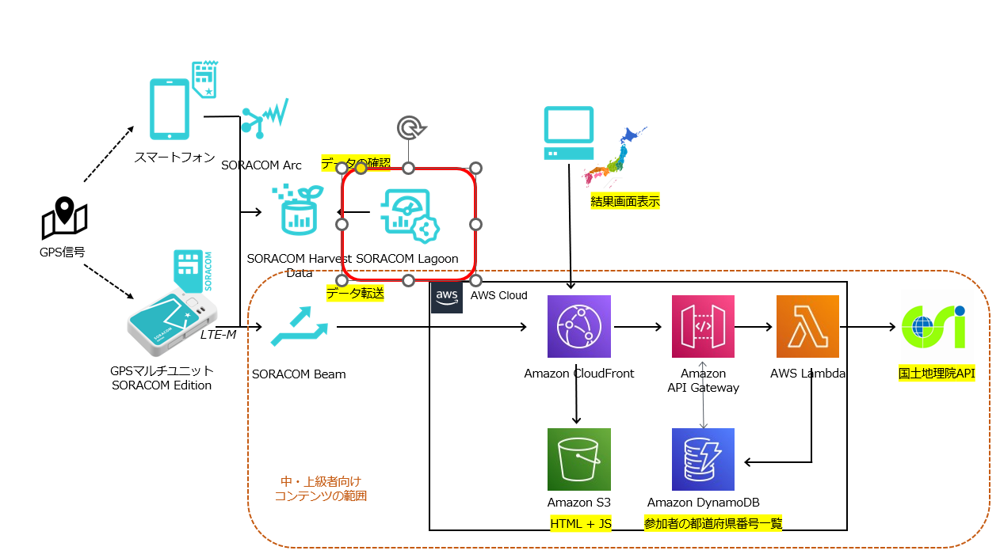

## SORACOM Lagoon3の利用を開始する

公式ドキュメントの[SORACOM Lagoon3の利用を開始する](https://users.soracom.io/ja-jp/docs/lagoon-v3/getting-started/)を参考に、Lagoonの利用を開始します。

プランは「Free」を選択してください。

## IMSIを確認する

GPSマルチユニットで利用しているSIM(GPSトラッカーシミュレーターの場合は仮想SIM)のIMSIを確認します。

SORACOMのユーザーコンソールから、[メニュー] → [SORACOM Air for Cellular] -> [SIM 管理] の順にクリックし、SIM管理画面を表示します。

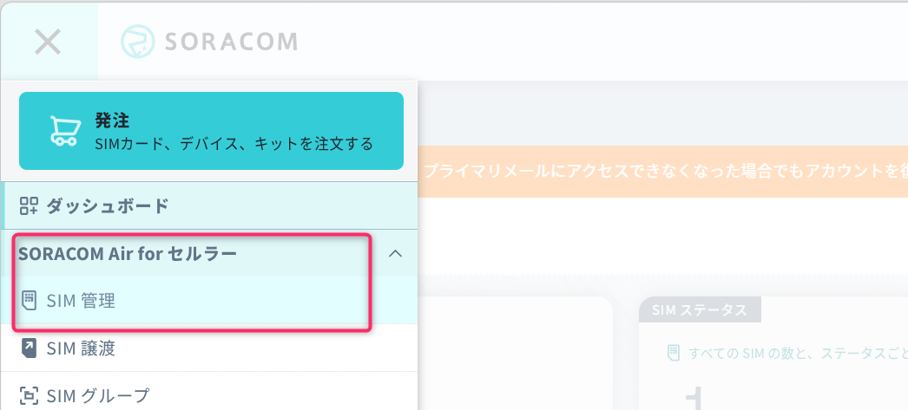

GPS マルチユニットの IoT SIM にチェックを入れて、[詳細] をクリックします。

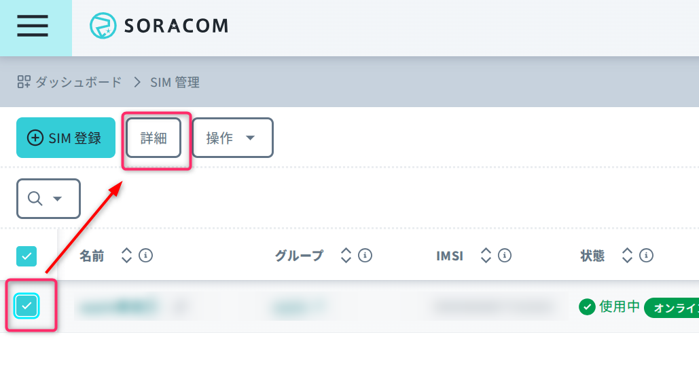

[IMSI] をテキストエディタなどにメモします。

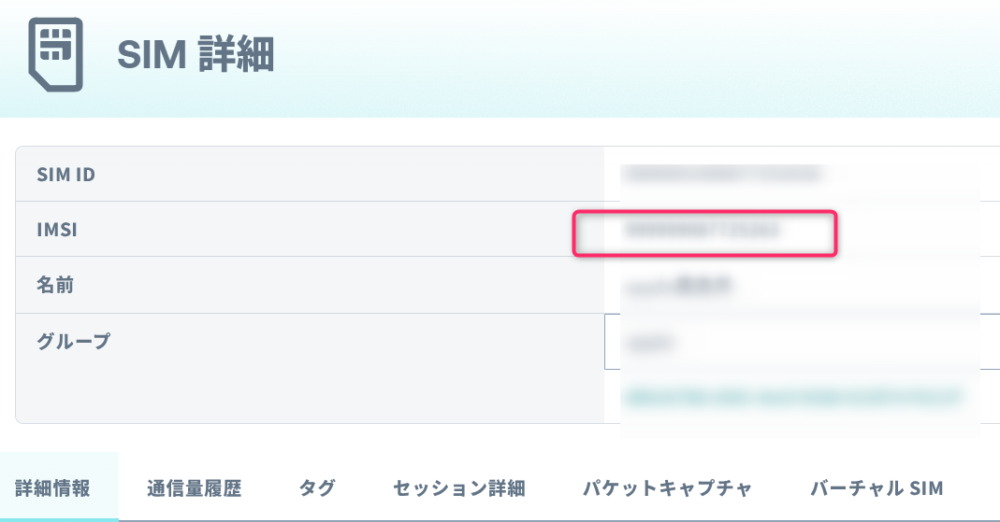

## サンプルダッシュボードの準備をする

[GPSマルチユニットサンプルダッシュボード](https://try.soracom.io/lagoon-gallery/gps-multiunit-sample) にアクセスし、[このダッシュボードを使う] をクリックします。

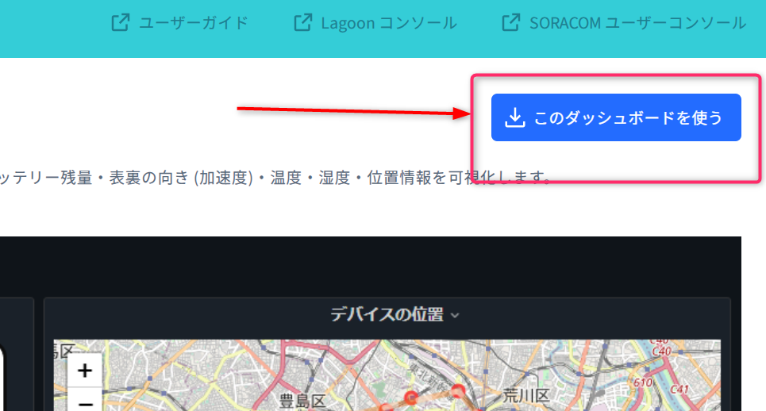

先ほどメモしたIMSIを入力し、「テンプレートを作成する」  

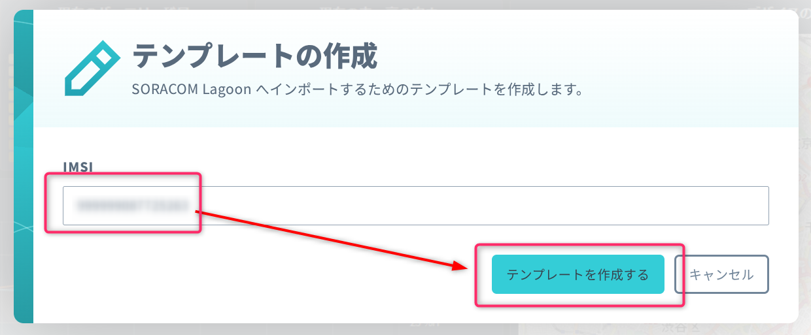

「クリップボードにコピー」をクリックし、「SORACOM Lagoonでインポート」をクリックします。

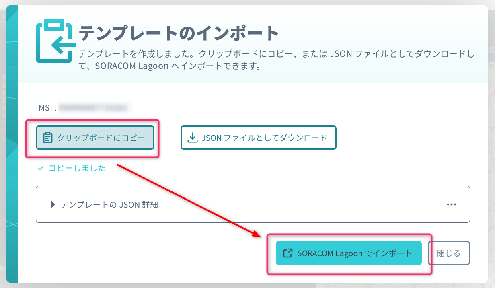

## Lagoonにインポートする

先ほどボタンをクリックすると、Lagoonのログイン画面が表示されます。  
SORACOM ユーザーコンソールのルートユーザーのメールアドレスと、「SORACOM Lagoon 3 の利用を開始する」で設定したパスワードを入力します。

ログインに成功すると、import画面が表示されます。「import via pane json」にクリップボードの中身を貼り付け、「Load」ボタンをクリックします。

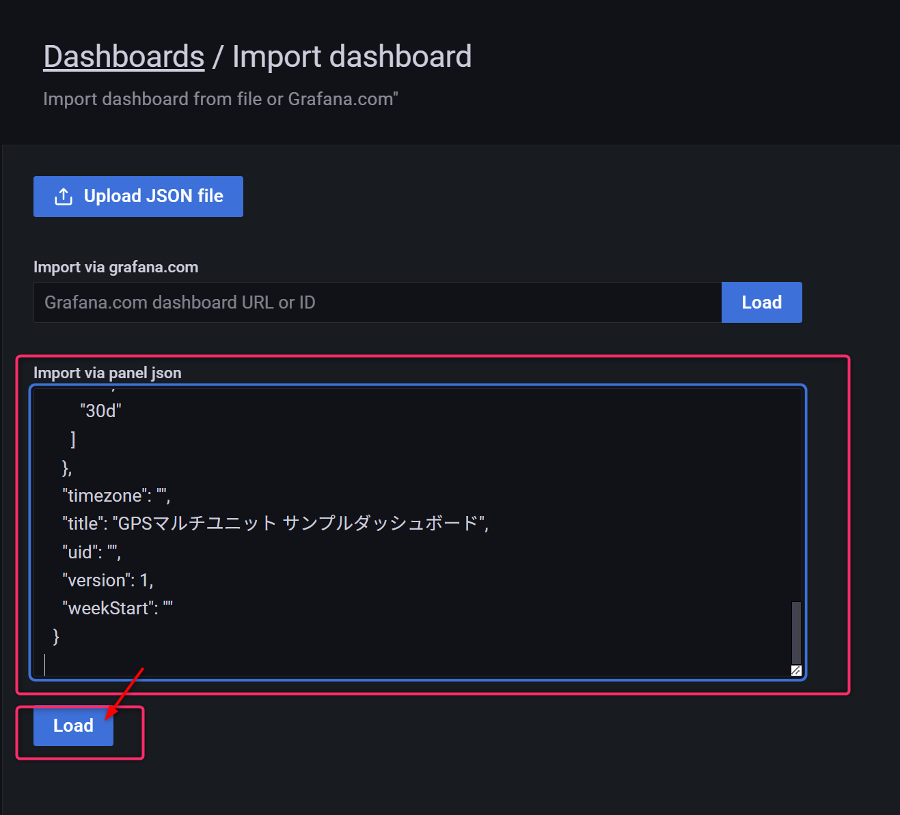

確認画面で「Soracom」のプルダウンメニューで「Soracom(default)」を選び、「import」ボタンをクリックします。

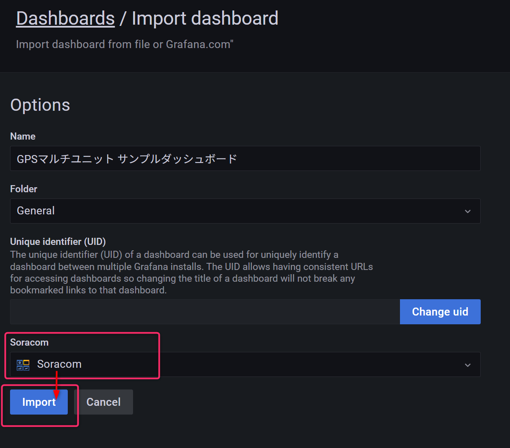

エラーが表示されますが無視します。

左の柱の上から3番目のアイコンをクリックし、「Dashboards」をクリックします。  
「GPSマルチユニットサンプルダッシュボード」が表示されるので、これをクリックします。

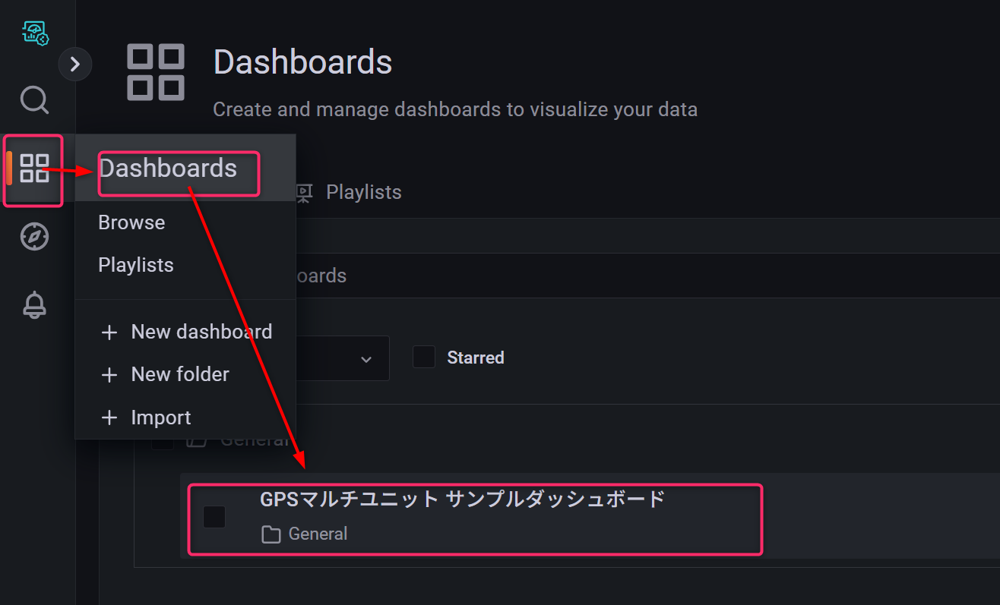

サンプルダッシュボードが表示されたら成功です。

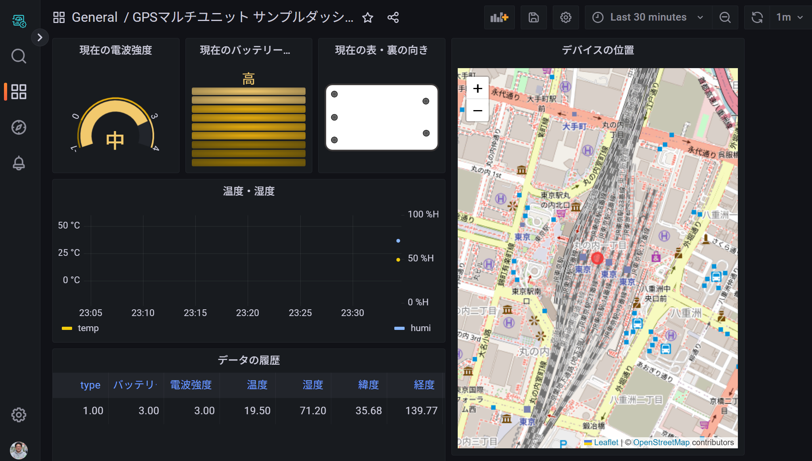

---

- 次: [4: 中・上級者向け追加コンテンツ](../chapter4/README.md)  
99: [後片付け](../chapter99/README.md)

- 前: [2: GPSマルチユニット初期設定(ガジェット設定〜Harvest動作確認)](../chapter2/README.md)
