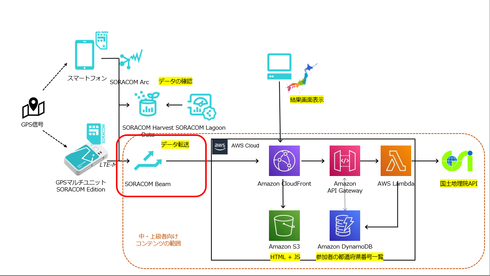
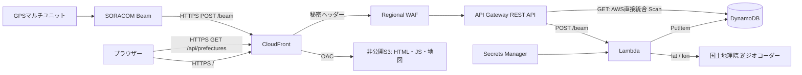
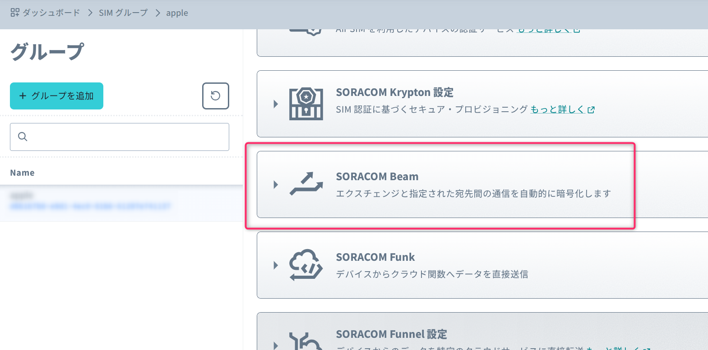
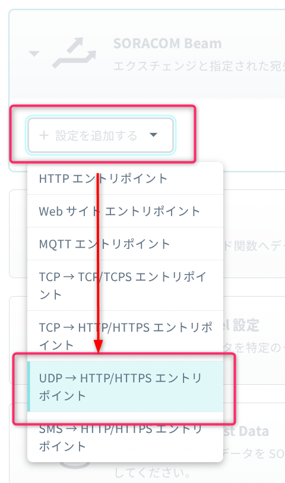
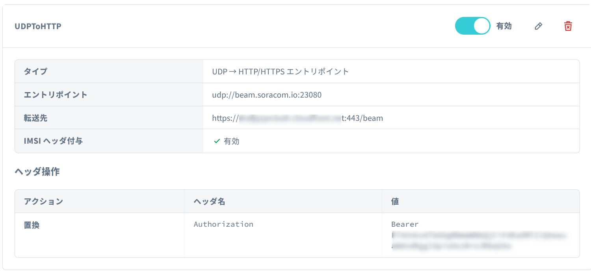

# 4: 中・上級者向け追加コンテンツ

運営が準備したAWS環境に位置情報を送ることで、本ハンズオンを実行している人がどの都道府県にいるのかを可視化してみます。

## AWSアーキテクチャ

## SORACOM Beam設定

コンソールの[SORACOM Air forセルラー]->[SIMグループ]からGPSマルチユニット(またはGPSトラッカーシミュレーター)で利用しているSIMグループをクリックし、[SORACOM Beam] を開きます。

[設定を追加する]をクリックし、「UDP→HTTP/HTTPSエンドポイント」をクリックします。

以下の情報を入力します。

| 項目 | 値 |
|---|---|
| ホスト名 | (当日運営から入手) |
| ポート番号 | 443 |
| パス | `/beam` |
| IMSIヘッダー | 有効 |

カスタムヘッダーの[+追加]をクリックします。  
アクションを「置換」、ヘッダ名を `Authorization` に設定します。「値」には当日運営から入手した情報を入力します。

最後に「保存」を押します。  
以下のような画面になっていれば設定は完了です。

## 確認

GPSマルチユニット(GPSトラッカーシミュレーター)からデータが送られると、IMSIを暗号化(ハッシュ化)した情報と、位置情報を国土地理院APIで都道府県番号に逆ジオコーディングした結果がDynamoDBに保存されます。

**保存されるIMSIは暗号化(ハッシュ化)されているため、元の値を特定することはできません。また、位置情報も都道府県番号に変化後に保存しています。このため、皆さんが送信した情報は、内容が分かる形では本環境には保存されませんのでご安心ください。**

どの都道府県に何件登録されたかが、日本地図を使って表示されます。URLは当日運営から入手してください。

## 次のステップ

[本リポジトリの`src`ディレクトリ](https://github.com/soracomug/explorer2026-hands-on-gpsmultiunit/tree/main/src)に、GPSマルチユニットから送信されたデータを処理するLambda関数や、DynamoDBに保存されたデータを表示するWebアプリケーションのソースコードが含まれています。

AWSの環境をお持ちの方は、[`src/README.md`](https://github.com/soracomug/explorer2026-hands-on-gpsmultiunit/tree/main/srcREADME.md)を参考に、ご自身の環境でLambda関数やWebアプリケーションを動かしてみてください。

---

次:  
99: [後片付け](../chapter99/README.md)

前: [3: SORACOM Lagoon設定](../chapter3/README.md)
