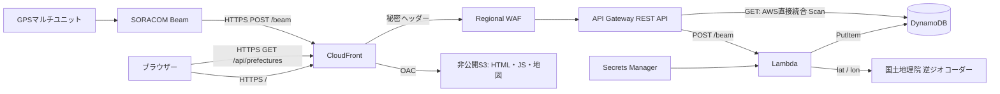

# GPSマルチユニットの都道府県マップ

AWS CDK (TypeScript)、Node.js Lambda、静的HTML/JavaScriptによるハンズオンです。AWSへのデプロイは実行していません。

## 構成



Lambda、API Gateway、DynamoDB、S3、Secrets Manager、WAFは `ap-northeast-1` に配置します。CloudFrontはグローバルサービスです。サイト・Beam入口・読取APIは同じCloudFrontドメイン配下です。読取経路にLambdaは使いません。

| ファイル | 用途 |
| --- | --- |
| [infra/lib/gps-map-stack.ts](infra/lib/gps-map-stack.ts) | AWSリソース・アクセス権・DynamoDB直接統合・CORS |
| [lambda/ingest.mjs](lambda/ingest.mjs) | Beamデータの検証・都道府県判定・保存 |
| [web/index.html](web/index.html) | 静的画面 |
| [web/app.mjs](web/app.mjs) | 白地図・5段階の配色・自動更新 |
| [web/data.mjs](web/data.mjs) | JISコード対応・全件取得・件数集計 |
| [tests/ingest.test.mjs](tests/ingest.test.mjs) | Lambdaの回帰テスト |
| [tests/data.test.mjs](tests/data.test.mjs) | 地図・集計・分割Scanのテスト |

## 前提

- Node.js 22以上、npm、AWSの認証情報を設定したAWS CLI/CDK実行環境。
- 対象AWSアカウントでCDK bootstrapを実行できる権限と、利用サービスの作成権限。
- GPSマルチユニットSORACOM Edition、SORACOM SIM、Beam設定を変更できるSORACOMアカウント。
- 国土地理院のAPIへインターネット接続できること。LambdaはVPCに入れない構成です。

## ビルドとデプロイ

リポジトリ直下から実行します。

```bash
cd src
npm ci
npm test
export AWS_REGION=ap-northeast-1
export AWS_DEFAULT_REGION=ap-northeast-1
npm run synth

# 初回のみ。ACCOUNT_IDをデプロイ先の12桁アカウントIDに置換します。
npx cdk bootstrap aws://ACCOUNT_ID/ap-northeast-1
npm run deploy
```

AWSプロファイルを使う場合は事前に `AWS_PROFILE` を設定してください。CDKアプリは東京以外の既定リージョンを検出すると停止します。CloudFormationの変更内容・IAM権限・費用を確認し、CDKの承認操作はご自身で行ってください。

ビルド成果物は `dist/lambda`、`dist/web`、`dist/infra` に出力します。地図とアイコンも同梱し、公開画面は外部CDNに依存しません。BucketDeploymentがS3へ配置し、CloudFrontを無効化します。

主なCDK出力:

- `WebsiteUrl`: `https://<distribution>.cloudfront.net/`
- `BeamEndpoint`: 同じドメインの `/beam`
- `ReadEndpoint`: 同じドメインの `/api/prefectures?segment=0&segments=1`
- `BeamTokenSecretArn`: Beamに設定する認証トークンのSecret ARN
- `ImsiHashSecretArn`: IMSI匿名化専用Secret ARN。Beam・ブラウザーには配布しません。
- `TableName`: DynamoDBテーブル名

## SORACOM Beam設定

1. Secrets Managerの `BeamTokenSecretArn` に対応する秘密値を、AWSコンソールで権限のある管理者が確認します。秘密値をGit、ブラウザー、ログ、チャットに貼らないでください。
2. GPSマルチユニットの送信先をBeamに設定します。UDPの場合は `beam.soracom.io:23080`、統合エンドポイントを使う場合はBeamへの転送を有効にします。端末のバイナリ送信形式を使う場合は、SORACOM側のバイナリパーサー等で `lat`、`lon` が数値のJSONになるように設定してください。
3. SIMグループのBeam設定で、転送先を `BeamEndpoint` にします。プロトコルはHTTPS、ポート443、パス `/beam` です。Lambdaへ届くJSONの直下に数値の `lat` / `lon` が含まれる転送・バイナリパーサー設定にしてください。
4. 「IMSIヘッダーを付与」を有効にします。
5. カスタムヘッダー `Authorization` を **replace** にし、値を `Bearer <Beamの秘密値>` に設定します。appendは使わず、端末が送った値を置換します。HTTPエントリーポイントの場合は、Beamの認証情報ストアのBearerヘッダー設定も利用できます。
6. サービスへの送信間隔を十分に空けてください。Lambdaの予約同時実行数は5、API全体のレート制限は10リクエスト/秒です。

HTTP転送では、ボディに次のJSONを受け付けます。IMSIはボディではなく `X-Soracom-IMSI` ヘッダーから取得します。

```json
{"lat":35.681236,"lon":139.767125,"battery":4.1}
```

Lambdaは `event.body` のJSON直下から `lat` / `lon` を取得し、`payload` のラップ形式は扱いません。ラップ形式で届く設定の場合は、SORACOM側で直接JSONになるよう設定を確認してください。API Gateway自身が `isBase64Encoded: true` を指定した場合のボディ復号には対応しています。メソッドはHTTP API v2の `requestContext.http.method`、またはREST APIの `httpMethod` から取得します。CDKは引き続きREST APIを作成します。文字列の緯度経度、不正なIMSI、認証エラーは保存しません。`X-Soracom-Signature` は検証せず、HTTPSと共有BearerトークンでBeamを認証する実装です。提示された実機イベントのように `Authorization` がない場合は401になるため、Beamで認証ヘッダーを付与してください。

## 位置判定と保存

国土交通省の外局である国土地理院の逆ジオコーダーを使用します。国土交通省の不動産情報ライブラリAPIとは別のサービスであり、APIキーは不要です。

```text
https://mreversegeocoder.gsi.go.jp/reverse-geocoder/LonLatToAddress?lat=<lat>&lon=<lon>
```

応答 `results.muniCd` は5桁の市区町村コードです。先頭2桁をJIS X 0401の都道府県番号（1～47）に変換します。例えば `13101` は東京都の `13` です。該当する市区町村がない場合は422、外部APIのエラーや5秒のタイムアウトは502とし、既存データは変更しません。保存失敗は503です。

この逆ジオコーダーは地理院地図で使われているサービスです。正式な商用SLA付きAPIではなく、仕様変更・停止・境界付近の判定誤差があり得ます。公開前に[国土地理院コンテンツ利用規約](https://www.gsi.go.jp/kikakuchousei/kikakuchousei40182.html)と[地理院地図利用規約](https://maps.gsi.go.jp/help/termsofuse.html)を確認し、大量・高頻度の利用は避けてください。独立した判定APIの利用許諾・安定性を保証するものではありません。

DynamoDBのレコードは次の2属性だけです。

```json
{"deviceKey":"HMAC-SHA256(IMSI, 専用秘密鍵)の64桁hex","prefecture":13}
```

同じSIMは同じパーティションキーに上書きするので、地図の台数は**各SIMの最後に受信した位置**の件数であり、過去の測位回数ではありません。生IMSI・緯度経度・その他の端末情報は保存しません。IMSIが推測可能な番号であるため、単純SHA-256ではなく秘密鍵付きHMACを使用します。匿名化は完全な個人情報除去を保証するものではありません。

Secretは認証用・匿名化用・CloudFrontオリジン用の3個を自動生成します。Lambdaは実行時に必要な2個だけを取得し5分間キャッシュします。認証トークンを変更した際はBeamも更新し、最大5分のキャッシュに注意してください。匿名化用秘密鍵を変更すると同一SIMのキーが変わるため、無計画なローテーションは二重計上を招きます。CloudFrontオリジン用Secretの変更は、CloudFrontとWAF両方の更新と反映順序を管理する必要があります。自動ローテーションは有効にしていません。

## 全件取得と色分け

```http
GET /api/prefectures?segment=0&segments=1
```

通常の応答:

```json
{"items":[{"prefecture":13},{"prefecture":13},{"prefecture":27}],"splitRequired":false}
```

API GatewayのAWS直接統合でDynamoDBのScanを実行します。`ProjectionExpression` を `prefecture` に固定し、レスポンステンプレートも同属性だけを返します。ブラウザーからテーブル名や取得属性を変更できません。APIのIAMロールはこのテーブルのScanだけを許可します。

DynamoDBのScanは1リクエスト最大1MBです。通常のページングでは `LastEvaluatedKey` に匿名化IMSIが含まれるため、本実装はキーをページング用トークンとしても公開しません。途中で打ち切られたScanには `{"items":[],"splitRequired":true}` を返します。ブラウザーは分割数を1→2→4…と増やし、**すべての分割を先頭から再取得**します。途中ラウンドの結果は破棄し、全分割が完了したラウンドだけを表示するので、二重計上しません。分割番号は0から `segments - 1`、最大分割数はDynamoDBの上限1,048,576です。並列4リクエスト、全体の取得タイムアウト60秒です。

この方式はキー非公開と直接統合を両立させるためのハンズオン向け設計です。データ量が大きい場合は再Scanが高コストになるため、DynamoDB Streams等で作る集計テーブルやサーバー側の集計APIに移行してください。`ConsistentRead` を有効にしてもScan全体のスナップショット分離はなく、更新と取得が重なると厳密な同一時点の集計にはなりません。

API Gatewayの429レート制限は、1・2・3秒の待機で最大3回再試行します。同じ分割を再取得し、成功した応答だけを追加するため、再試行による二重計上はありません。それ以外のエラーや、再試行後も続く429は画面に表示します。

地図は0台が白、1～4台は各段階、5台以上は最も濃い色の合計5段階です。1台目から視認しやすい色で表示します。30秒ごとに再取得し、15秒・60秒への変更、自動更新停止、手動更新にも対応します。タブ非表示中は定期取得を停止します。取得エラー時は前回表示を維持し、未取得状態を0台と扱いません。

## セキュリティとSTSの判断

- S3はBlock Public AccessとCloudFront OACを使用し、S3ウェブサイト公開はしません。
- CloudFrontからAPI Gatewayへ秘密ヘッダーを付け、Regional WAFで一致するリクエストのみ許可します。API Gateway標準URLへの直接アクセスは拒否されます。WAFのサンプルリクエスト記録とAPI Gatewayの詳細な実行ログは無効です。簡易アクセスログにはリクエストID・ステータス・統合エラーを記録します。
- APIとBeamのCloudFront経路はHTTPSのみ、キャッシュは無効です。Authorization、Origin、クエリーを転送し、HostはAPIのものへ置き換えます。
- CORSの許可元は自分のCloudFront originだけです。OPTIONSはGETとContent-Typeを許可します。CSPの `connect-src 'self'` でも同一オリジンへの接続に限定します。
- **CORSは認証ではありません。** 他サイトのブラウザーによる応答読取りは防ぎますが、curl等によるCloudFront経由の公開APIアクセスは防ぎません。サイトと都道府県番号の一覧は匿名公開する前提です。WAFの秘密ヘッダーも閲覧者の認証にはなりません。
- ブラウザーにAWSアクセスキーやBeamトークンを埋め込みません。現構成にはSTSを導入していません。公開白地図の表示だけならSTSを使っても匿名Identity Poolはアクセス制限にならず、複雑さだけが増えるためです。
- **利用者を認証して非公開にする場合**は、Cognito User Poolでログインし、Identity PoolからSTSの短期認証情報を取得、読取メソッドを `AWS_IAM` に変更してSigV4で署名します。権限は該当GETメソッドの `execute-api:Invoke` のみに限定します。CloudFrontはAuthorizationと必要な `X-Amz-*` ヘッダーを転送し、署名にはオリジンのAPI Gateway Hostと `/prod/api/prefectures` を使う必要があります（CloudFront Hostで署名するとオリジンで検証失敗します）。CORSの許可ヘッダーも更新してください。Bearer形式のCognito Authorizerを使いSTSを使わない方式の方が、同一CloudFront配下では実装が簡単です。どちらも本実装には含めず、閲覧対象を非公開化すると決めた段階で追加する設計判断です。

CloudFrontの既定証明書を使用しています。独自ドメインでTLS 1.2以上のポリシーを明示したい場合は、`us-east-1` のACM証明書と独自ドメインを追加してください（証明書がない状態の `minimumProtocolVersion` 指定には効果がありません）。

## 地図の利用許諾

[@svg-maps/japan 1.0.1](https://www.npmjs.com/package/@svg-maps/japan) に含まれる、MapSVGを原著作者とする47都道府県のSVG形状データを利用します。ライセンスは[CC BY 4.0](https://creativecommons.org/licenses/by/4.0/)で、著作者の表示・ライセンスへのリンク・変更の明記を行えば、公開・商用サービスでも利用できます。パッケージはVictor Cazanaveによる変換版です。

画面フッターにMapSVG・svg-mapsへのリンク、ライセンス、配色・ラベル変更の表示を配置し、ビルド時にパッケージの出典情報も `dist/web/MAP-LICENSE.md` に同梱します。コードのリポジトリライセンスと地図データのライセンスは別です。地図は表示用の簡略化された形状で、測量・境界判定には使用しません。

## ローカル確認と検証

```bash
# srcで実行
npm run build
npm test
npm run serve
```

プレビューは `http://127.0.0.1:8080` です。使用中なら次の空きポートに切り替えます。ローカルサーバーのAPIは503を返し、AWSデータのダミー表示やローカルからの別オリジン接続は行いません。ライブデータを確認する場合は、CDKデプロイ後の `WebsiteUrl` を開いてください。

テストは国土地理院・Secrets Manager・DynamoDBをモックして実行し、AWSに書き込みません。CDK synthでスキーマとリソース依存関係を検証します。実AWSの統合テスト、SORACOM実機送信、API Gateway上のVTL実行、CloudFront/WAFの遮断、実配信時のCORSはデプロイ後に確認が必要です。

デプロイ後の確認項目:

1. 実機から送信し、DynamoDBに匿名化キーと都道府県番号のみが保存されること。
2. 同じSIMから再送し、項目数が増えず都道府県が上書きされること。
3. `WebsiteUrl` を開き、複数SIMが同県なら台数と色が変わること。
4. CloudFront読取APIの応答に `deviceKey` / `LastEvaluatedKey` がなく、他オリジンはCORSで読取不可であること。
5. API Gateway標準URLへのアクセスがWAFで拒否され、BeamトークンなしのCloudFront POSTが401になること（ボディ不正は400）。
6. 国土地理院の該当なし・障害時に既存データが消えず、読取失敗時に画面が古いデータであると明示されること。

## 費用と削除

WAF（Web ACL・ルール・リクエスト）、Secrets Manager（3個）、DynamoDBとPITR、Lambda、API Gateway、S3（バージョニング）、CloudFront、ログ、CDKの配置用リソースに費用がかかります。無料枠内を保証しません。公開APIは認証がないため、濫用対策が必要な運用では追加のWAFレート制限や認証を検討してください。

削除は東京リージョン設定のまま `npx cdk destroy` を実行します。データ保護のためDynamoDB・S3・Secrets・LambdaログはRETAINです。スタック削除後も残り、費用が継続する場合があります。不要になったデータ・S3の全バージョン・秘密・ログ・CDK bootstrap資源は、影響を確認した上で管理者が別途削除してください。
